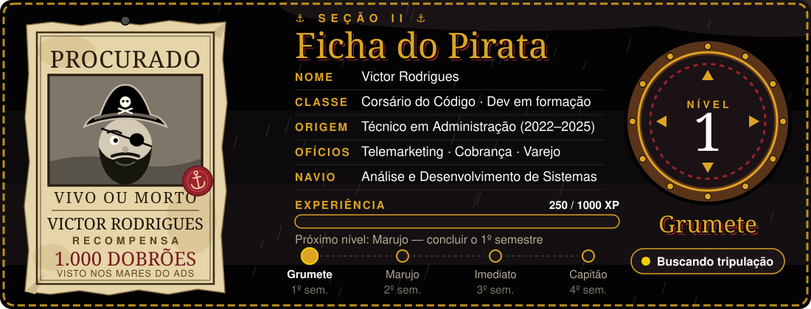
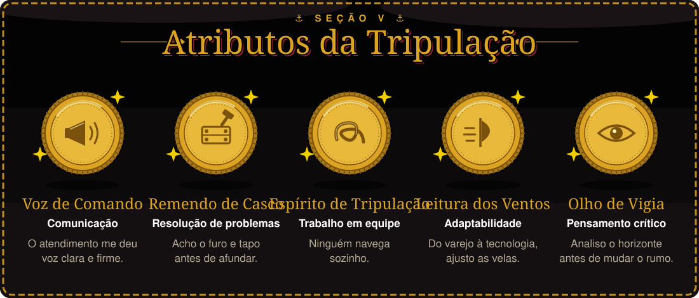
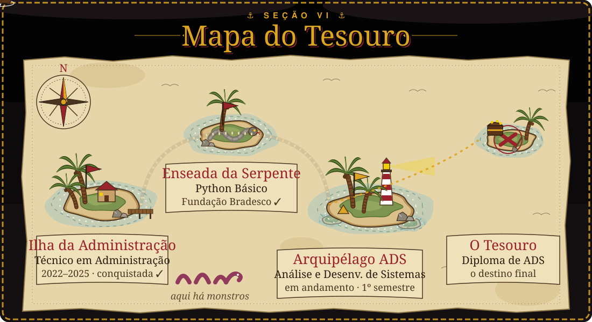
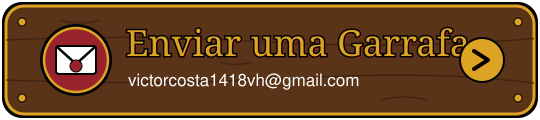
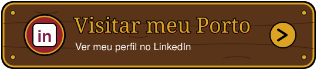

<!-- ===================== 🏴‍☠️ SEÇÃO 1 — BANDEIRA DO NAVIO ===================== -->

 

 

---

<!-- ===================== 📜 SEÇÃO 2 — FICHA DO PIRATA ===================== -->

  

---

<!-- ===================== 📖 SEÇÃO 3 — DIÁRIO DE BORDO ===================== -->

  

---

<!-- ===================== ⚔️ SEÇÃO 4 — ARSENAL ===================== -->

  

---

<!-- ===================== 🧭 SEÇÃO 5 — ATRIBUTOS DA TRIPULAÇÃO ===================== -->

  

---

<!-- ===================== 🗺️ SEÇÃO 6 — MAPA DO TESOURO ===================== -->

  

---

<!-- ===================== 💎 SEÇÃO 7 — BAÚ DE CONQUISTAS ===================== -->
<!-- Gerado automaticamente todo dia pela Action ".github/workflows/conquistas.yml" -->

  

---

<!-- ===================== 🍾 SEÇÃO 8 — MENSAGEM NA GARRAFA ===================== -->

  
    
  
  
    
  ⚓ Até a próxima maré, marujo! ⚓

